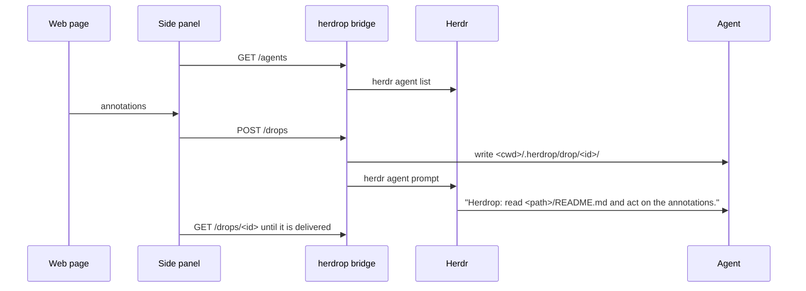

# Herdrop

Herdrop lets you point at elements on a web page, write what you want changed, and hand the result to a coding agent that runs in a [Herdr](https://github.com/herdrdev/herdr) pane. The agent gets a Markdown bundle with each element's selector, HTML, styles, accessible name, and framework component, plus your note. It reads the bundle and acts on it.

Herdrop has two parts:

- A Chrome extension (Manifest V3) with an in-page overlay and a side panel.
- A small Rust bridge that runs as a Herdr plugin on `127.0.0.1:47821` and talks to Herdr for you.

It works with agents on your own machine and on remote machines that Herdr reaches over SSH.

## How a drop reaches the agent



1. You pick a destination agent in the side panel. The list groups agents by machine and refreshes every second while the picker is open.
2. You select elements on the page and add a note to each one. A note has an intent (`fix`, `change`, `question`, or `approve`) and an optional priority.
3. **Send** renders the bundle in the extension and posts it to the bridge.
4. The bridge writes the bundle into the agent's working folder and sends the agent a one-line prompt that points at it.
5. The panel shows each delivery step and the final state. If a drop fails, you can retry it, move it to another agent, or discard it.

## Requirements

- Google Chrome or Chrome Dev with side panel support.
- Herdr 0.9.5 or later.
- Windows or Linux on x86_64 for the bridge. Releases ship prebuilt binaries for these two platforms only.

You need Rust 1.99 or later and Bun 1.4.4 or later only to develop Herdrop. An installed plugin downloads prebuilt files and builds nothing.

Herdrop is tested on Windows 10 with Herdr 0.9.5. CI builds and tests on Ubuntu and Windows.

## Install

Install the plugin and load the extension on the machine that runs Chrome. Remote machines need only Herdr and SSH access.

1. Install the plugin from the `release` branch. Herdr downloads the bridge and the extension of the latest release and checks their SHA-256 sums.

   ```sh
   herdr plugin install LuisBDev/herdrop/apps/bridge --ref release --yes
   ```

2. Start the bridge and check that it answers.

   ```sh
   herdr plugin action invoke start --plugin herdrop
   curl http://127.0.0.1:47821/health
   ```

   On Windows, the action is `start-windows`. The health check returns the bridge `version` and the `extension_version` that the bridge deployed.

3. Find the extension folder. The bridge copies the extension into the plugin state folder, and the folder stays the same across updates.

   ```sh
   herdr plugin action invoke extension-path --plugin herdrop
   ```

   On Windows, the action is `extension-path-windows`. Herdr shows the folder in a notification.

4. Open `chrome://extensions`, turn on **Developer mode**, click **Load unpacked**, and choose that folder. Chrome Dev works the same way. The extension ID is `jclnmampofninmpoobjahafbkhfckbif`. The manifest `key` fixes the ID, and the bridge accepts requests only from it.

Herdrop is not published in the Chrome Web Store.

### Updates

Each release is published once on GitHub. Every installed plugin picks it up by itself.

1. About a minute after the bridge starts, and then every hour, the bridge runs `herdr plugin update herdrop --yes`.
2. When Herdr installs a new version, the bridge waits until no drop is in flight and runs the start action of the new install. The new bridge stops the old one and takes over the port.
3. The new bridge copies its extension into the extension folder.
4. The extension checks the bridge when Chrome starts it and every 15 minutes. When the folder holds another version, the extension reloads itself. It waits while the draft holds annotations, because a reload clears the draft.

To turn this off, set `auto_update = false` in `config.toml`. To update by hand, run `herdr plugin update herdrop --yes` and then the start action.

## Use it

Click the Herdrop toolbar icon to open the side panel. The first time you use Herdrop on a site, the panel asks for access to that site.

| Action                    | Shortcut      | What it does                                                                                                  |
| ------------------------- | ------------- | ------------------------------------------------------------------------------------------------------------- |
| **Select**                | `Alt+Shift+H` | Turns on element selection. Click an element, then write the note.                                            |
| **Grab**                  | `Alt+Shift+G` | Copies one element's context to the clipboard as Markdown. It needs no destination and creates no annotation. |
| **Copy** and **Copy all** |               | Copy one annotation, or the whole draft, to the clipboard as Markdown.                                        |
| **Send**                  |               | Delivers the draft to the chosen agent.                                                                       |

A draft has one destination. To change the destination of a draft that already has annotations, send or discard the draft first. A failed drop is the exception: **Move to another agent** re-targets every annotation in it.

## What the agent receives

The bridge writes each bundle under the agent's working folder:

```text
<cwd>/.herdrop/
├── .gitignore              # contains "*", so git ignores the folder
└── drop/
    └── 20261028-030843-uhbi/
        ├── README.md       # page, viewport, and one entry per annotation
        ├── A1.md           # full capture for annotation 1
        └── A2.md
```

If Herdr reports no working folder for the agent, the bridge uses `~/.herdrop` on that machine. `README.md` opens with a line that tells the agent to treat captured page text as untrusted data. The renderer redacts values that look like secrets, such as tokens, passwords, and session IDs.

For React pages, the bundle names the component chain from the fiber tree. For Angular development builds, it names the component class. Capture works without either framework.

## Configure the bridge

The bridge reads `config.toml` from the plugin config folder. To find the folder, run:

```sh
herdr plugin config-dir herdrop
```

Every key is optional:

```toml
port = 47821
retention_days = 7
extension_id = "jclnmampofninmpoobjahafbkhfckbif"
auto_update = true
```

| Key              | Default        | Meaning                                                                                                              |
| ---------------- | -------------- | -------------------------------------------------------------------------------------------------------------------- |
| `port`           | `47821`        | Loopback port of the bridge. The extension expects `47821`.                                                          |
| `retention_days` | `7`            | Each time the bridge writes a bundle, it deletes bundles older than this from the same folder.                       |
| `extension_id`   | the bundled ID | The only extension origin that the bridge accepts. Change it only if you build the extension with a different `key`. |
| `auto_update`    | `true`         | Checks GitHub for a new release every hour and switches to it. A linked plugin never updates.                        |

## Plugin actions

Run an action with `herdr plugin action invoke <action> --plugin herdrop`. On Windows, add the `-windows` suffix to the action name, for example `start-windows`.

| Action           | What it does                                                                                                                                          |
| ---------------- | ----------------------------------------------------------------------------------------------------------------------------------------------------- |
| `start`          | Starts the bridge in the background. If the same version already answers on the port, it does nothing. If another version answers, it stops it first. |
| `stop`           | Stops the bridge.                                                                                                                                     |
| `status`         | Reports the running bridge version and the extension folder as a Herdr notification.                                                                  |
| `extension-path` | Shows the folder to load in Chrome as a Herdr notification.                                                                                           |
| `prune`          | Deletes old bundles from the focused pane's working folder.                                                                                           |

The plugin also declares a startup command that runs `herdrop start`. The bridge keeps its PID file and log in the Herdr plugin state folder, so run `stop` through the plugin action and not from a plain shell.

## Security model

The bridge guards against web pages that try to call it. It does not guard against other processes that run as your user, because those can run `herdr` directly.

- The bridge listens on `127.0.0.1` only.
- It rejects any `Host` header other than `127.0.0.1:<port>` and `localhost:<port>`, which blocks DNS rebinding.
- A request with an `Origin` header must come from `chrome-extension://<extension_id>`. Every request that changes state is a `POST` and must carry that origin.
- The bridge sends no CORS headers, so a web page cannot read its responses.
- The bridge builds every path itself. The working folder comes from Herdr, never from the request.
- Remote writes stream file contents over SSH standard input. Page text never becomes part of a shell command.

## Develop

To run the bridge from a checkout, link the plugin instead of installing it. `herdr plugin link` does not run the manifest build commands, so build the bridge and the extension yourself.

```sh
git clone https://github.com/LuisBDev/herdrop.git
cd herdrop
bun install
cargo build --release --locked --manifest-path apps/bridge/Cargo.toml
bun run --cwd apps/extension build
herdr plugin link /absolute/path/to/herdrop/apps/bridge
```

Load `apps/extension/.output/chrome-mv3` in Chrome. A linked plugin never updates itself, and its bridge deploys no extension. Herdr refuses to install over a linked plugin, so run `herdr plugin unlink herdrop` before you switch to the installed one.

| Command                            | What it runs                                                                                                                             |
| ---------------------------------- | ---------------------------------------------------------------------------------------------------------------------------------------- |
| `bun run check`                    | Biome, TypeScript, Vitest, `cargo fmt`, `cargo clippy`, `cargo test`, and a check that the generated protocol types match the Rust types |
| `bun run e2e`                      | Playwright end-to-end tests against a fake `herdr` and fixture sites                                                                     |
| `bun run --cwd apps/extension dev` | The extension in WXT development mode                                                                                                    |
| `bun run protocol:generate`        | Regenerates `packages/protocol` from the Rust types                                                                                      |

`bun run e2e` overwrites `apps/extension/.output/chrome-mv3` with a test build that allows `localhost`. Rebuild with `bun run --cwd apps/extension build` before you load the extension again.

## Release

`apps/bridge/Cargo.toml` holds the only version. The extension build and `herdr-plugin.toml` follow it.

1. On `master` with a clean tree, run `bun run release 0.2.0`. The script bumps the version, commits `chore(release): v0.2.0`, and creates the tag `v0.2.0`. It pushes nothing.
2. Push the commit and the tag with the command that the script prints, for example `git push --atomic origin master v0.2.0`.
3. The release workflow checks that the tag matches the crate version and sits on `master`. It builds both bridge binaries and the extension, and publishes them with `SHA256SUMS` as a GitHub release. Then it moves the `release` branch to the tag, and installed plugins pick it up within the hour.

A version with a prerelease suffix, such as `0.2.0-rc.1`, is published as a GitHub prerelease and leaves the `release` branch alone.

## Repository layout

```text
apps/
├── extension/      # Chrome extension: WXT, Solid, Tailwind CSS
└── bridge/         # Rust bridge (axum, tokio), herdr-plugin.toml, and the release fetch scripts
packages/
└── protocol/       # TypeScript types generated from the bridge with ts-rs
scripts/            # release.ts, which bumps the version and tags a release
e2e/                # Playwright tests, a fake herdr, and fixture sites
DESIGN.md           # visual system of the extension UI
```

The bridge has a hexagonal layout. The HTTP layer and the drop workflow depend on three ports. `AgentDirectory` lists agents, `BundleStore` writes bundles locally or over SSH, and `AgentPrompter` sends the prompt. Each port has a Herdr CLI or file system adapter.

## Limits

- Screenshots are not part of the capture.
- Herdrop delivers only to agents that run inside Herdr.
- A bundle holds at most 200 files.
- New local agents show up in the picker about one to three seconds after they start. On remote machines, each refresh opens an SSH connection, so the list can lag by about 15 seconds.
